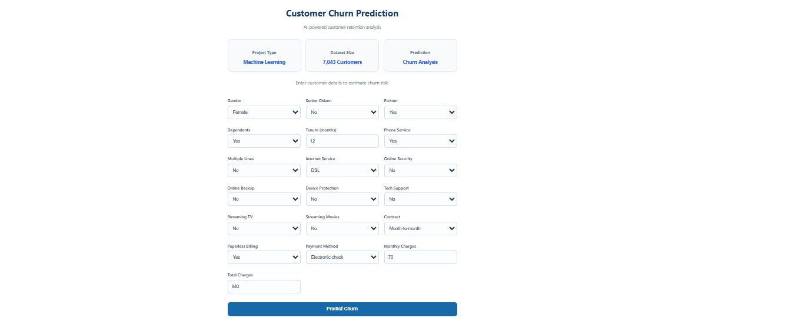
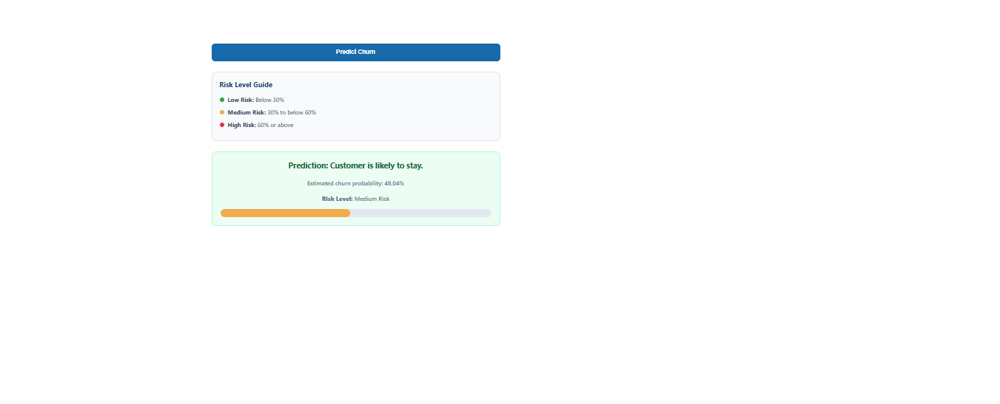

# Customer Churn Prediction

## Project Overview
This project predicts whether a telecommunications customer is likely to leave the company.

## Project Workflow

1. **Data Loading:** Loaded the Telco Customer Churn dataset using Pandas.
2. **Data Cleaning:** Handled missing values and prepared the data for analysis.
3. **Data Preprocessing:** Prepared numerical and categorical features for machine learning.
4. **Model Training:** Trained baseline and class-weighted Logistic Regression models using Scikit-learn.
5. **Model Evaluation:** Evaluated performance using accuracy, precision, recall, F1-score, and a confusion matrix.
6. **Threshold Analysis:** Compared classification thresholds to understand the trade-off between recall and precision.
7. **Deployment:** Built a Flask web application to predict customer churn and display risk levels.

## Objectives
- Predict customer churn using machine learning.
- Estimate churn probability.
- Classify customers into Low, Medium, and High risk levels.
- Provide predictions through a Flask web application.

## Technologies Used
- Python
- Pandas
- Scikit-learn
- Flask
- Joblib
- Jupyter Notebook
- HTML and CSS

## Machine Learning
The project uses a trained machine-learning pipeline to predict customer churn and estimate churn probability.

## Model Evaluation

The model was evaluated using different classification thresholds to understand the trade-off between accuracy, recall, and precision.

| Threshold | Accuracy | Recall | Precision |
|   ---     |    ---:  |   ---: |    ---:   |
| 0.30      | 74.95%   | 75.40% | 51.93%    |
| 0.40      | 77.71%   | 66.84% | 56.82%    |
| 0.50      | 80.55%   | 55.88% | 65.72%    |
| 0.60      | 79.91%   | 40.11% | 71.77%    |

### Weighted Logistic Regression Model Evaluation

I trained a second Logistic Regression model using `class_weight="balanced"` to address the imbalance between customers who churn and those who stay.

| Threshold | Accuracy | Recall | Precision |
|---:|---:|---:|---:|
| 0.30 | 65.44% | 92.78% | 43.00% |
| 0.40 | 70.12% | 86.63% | 46.62% |
| 0.50 | 73.81% | 78.34% | 50.43% |
| 0.60 | 76.22% | 70.59% | 53.99% |

The weighted model achieved **92.78% recall at a threshold of 0.30**, helping identify a larger proportion of customers who churn. At a threshold of 0.60, it achieved **76.22% accuracy and 53.99% precision**.

These results demonstrate the trade-off between identifying more customers who churn and reducing false-positive predictions. The appropriate threshold depends on the business objective.

A lower threshold identifies more customers who may churn, increasing recall but also producing more false positives. A higher threshold improves precision but may miss more customers who actually churn.

#### Classification Report at Default Threshold (0.50)

**Accuracy:** 73.81%

| Class | Precision | Recall | F1-score | Support |
|---|---:|---:|---:|---:|
| No Churn (0) | 0.90 | 0.72 | 0.80 | 1035 |
| Churn (1) | 0.50 | 0.78 | 0.61 | 374 |
| Macro Average | 0.70 | 0.75 | 0.71 | 1409 |
| Weighted Average | 0.80 | 0.74 | 0.75 | 1409 |

**Confusion Matrix**

[[747, 288],
 [ 81, 293]]

The weighted model uses `class_weight="balanced"` to give greater consideration to the minority churn class during training. At the default threshold of 0.50, it identifies 78.34% of customers who churn.

## Baseline Model Evaluation at Threshold 0.40

The model was evaluated using a classification threshold of 0.40.

### Model Performance

- **Accuracy:** 77.71%
- **Precision (Churn = Yes):** 57%
- **Recall (Churn = Yes):** 67%
- **F1-score (Churn = Yes):** 61%

### Confusion Matrix

|  | Predicted: No Churn | Predicted: Churn |
|---|---:|---:|
| Actual: No Churn | 845 | 190 |
| Actual: Churn | 124 | 250 |

### Interpretation

- **845** customers who did not churn were correctly identified.
- **190** customers who did not churn were incorrectly predicted to churn.
- **124** customers who churned were incorrectly predicted not to churn.
- **250** customers who churned were correctly identified.

The model identifies approximately 67% of customers who actually churned at this threshold. This makes recall an important metric when evaluating the model's ability to identify potential churners.

## Web Application
The Flask application accepts customer details and displays a churn prediction, probability, and risk level.

### Customer Details Form

### Prediction Result

## How to Run
1. Install the required packages:
   `pip install -r requirements.txt`
2. Start the application:
   `python app.py`
3. Open `http://127.0.0.1:5000` in your browser.

## Author
Supriya Zadge
